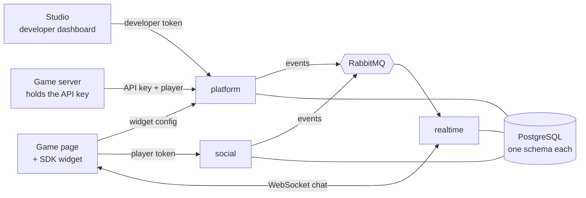

# clan-backend

[](https://gitlab.com/clan-platform/clan-backend/-/pipelines)


The backend of **Sociable**, a platform that gives any web game clans, friends and live chat. A game adds one
script tag and gets a ready-made social widget. Its developer designs that widget in Studio, and this
repository serves everything behind it: three Go services in one module.

| Service | Owns | Port |
|---|---|---|
| `services/platform` | Developers and their sessions, admins, games and their teams, API keys, the widget config (draft and published), player tokens | 8081 |
| `services/social` | Players, clans, members and roles, join requests, friends, blocks | 8082 |
| `services/realtime` | WebSocket connections, conversations, messages, read positions, presence, notifications | 8083 |



## Contents

- [Installation](#installation)
- [Usage](#usage)
- [Documentation](#documentation)
- [Contributing](#contributing)
- [Known issues](#known-issues)
- [Authors and contact](#authors-and-contact)
- [License](#license)

## Installation

You need:

- [Docker Desktop](https://www.docker.com/products/docker-desktop/) (Docker Compose)
- [Go](https://go.dev/dl/) 1.25 or newer, for running a service outside Docker and for the tests
- `openssl`, for the signing key (Git Bash has it on Windows)

1. Clone the repository and copy the settings:

   ```bash
   git clone https://gitlab.com/clan-platform/clan-backend.git
   cd clan-backend
   cp .env.example .env        # PowerShell: Copy-Item .env.example .env
   ```

   Set the five passwords in `.env` (letters and digits only).

2. Create the key that signs tokens (in Git Bash on Windows). It is never committed:

   ```bash
   mkdir -p secrets
   openssl genpkey -algorithm ed25519 -out secrets/platform_jwt_private.pem
   openssl pkey -in secrets/platform_jwt_private.pem -pubout -out secrets/platform_jwt_public.pem
   chmod 644 secrets/platform_jwt_private.pem secrets/platform_jwt_public.pem
   ```

3. Start everything: PostgreSQL, RabbitMQ, the migrations, the three services and the gateway.

   ```bash
   docker compose up --build
   ```

4. Check that the services are up:

   ```bash
   curl http://localhost:8081/ready    # platform
   curl http://localhost:8082/ready    # social
   curl http://localhost:8083/ready    # realtime
   ```

Running a service with `go run`, the gateway, migrations and images: [docs/running-the-backend.md](docs/running-the-backend.md).
Every part of the platform on one computer (Studio, SDK, demo game): [docs/running-locally.md](docs/running-locally.md).

## Usage

The usual way in is Studio ([clan-frontend](https://gitlab.com/clan-platform/clan-frontend)): register a developer,
create a game and an API key, and publish its widget. A game then signs its players in through its own server:

```bash
curl -s -X POST http://localhost:8081/api/v1/players/auth \
  -H "X-API-Key: clk_..." -H "Content-Type: application/json" \
  -d '{"externalPlayerId":"u_42","displayName":"Rashad"}'
# {"token":"eyJ...","expiresIn":3600}
```

The page passes that token to the SDK, which calls social and realtime with it. To try social without platform,
make a token from the command line:

```bash
go run ./tools/devtoken -player u_42 -name Ali
```

Check the whole flow against the running stack, from registering to clan chat:

```bash
go run ./tools/e2e          # one PASS line per step
```

Tests, before every merge request:

```bash
go vet ./...
go test -race ./...
```

## Documentation

| Read | For |
|---|---|
| [docs/overview.md](docs/overview.md) | Start here: the parts, a diagram, how a request flows |
| [docs/running-locally.md](docs/running-locally.md) | Every part of the platform on your computer |
| [docs/running-the-backend.md](docs/running-the-backend.md) | Docker Compose, the gateway, `go run`, migrations, container images |
| [docs/configuration.md](docs/configuration.md) | The signing key, every environment variable, tokens, sessions, email verification, admins, telemetry, CORS |
| [docs/development.md](docs/development.md) | Code layout, the rules, checks and tests |
| [docs/endpoints.md](docs/endpoints.md) | Every endpoint of the three services |
| [docs/api-reference.md](docs/api-reference.md) | Where each API contract lives (`openapi/`) |
| [docs/rabbitmq.md](docs/rabbitmq.md) | The broker, the event format, publishing and the outbox |
| [docs/events.md](docs/events.md), [docs/event-messages.md](docs/event-messages.md) | How events flow, and every message |
| [docs/realtime-flow.md](docs/realtime-flow.md) | The realtime flows as diagrams |
| [docs/operations.md](docs/operations.md) | Deploys, rollbacks, logs, the production database, admins |
| [deploy/helm/clan/README.md](deploy/helm/clan/README.md) | The Helm chart on the server |
| [loadtest/README.md](loadtest/README.md) | Load tests and their results |

## Contributing

- **Bugs and ideas:** open a ticket in the team's tracker (`TEAM-<number>`) or an issue in this project. Say what you
  did, what you expected and what happened.
- **Branches:** start from `develop` and name the branch after the change and its ticket, for example
  `fix/TEAM-123-clan-full-error` or `feat/TEAM-124-clan-tags`.
- **Commits:** `type(scope): what changed (TEAM-123)`, where the type is `feat`, `fix`, `docs`, `refactor` or `test`.
- **Merge requests:** into `develop`, which is protected, with `go vet` and `go test -race` passing on your machine
  (CI runs them on `main`, not on `develop`). Follow the rules in [docs/development.md](docs/development.md#rules).
- **Releases:** `develop` is merged into `main`, and **every merge to `main` is deployed** to the server.

## Known issues

- **Capacity:** the server holds about 500 players at once. At 500 its CPU reached about 95%, so more players need
  more CPU or the database on its own machine ([loadtest/RESULTS.md](loadtest/RESULTS.md)).
- **Realtime runs as one process.** Slow mode, the rate limit, presence timers and the config cache live in its
  memory: a restart resets them, and a second copy cannot be added yet.
- **Online status is late:** a friend who comes online after you connected shows as offline until you reconnect.
- **Open tabs go stale:** a renamed player, or a clan's member list after someone leaves, updates only on reload.
- **Clan rooms are not rebuilt:** if a clan event is lost, the clan has no chat room (or misses a member) until the
  next join.
- **One profanity list** for every game; a game can only switch the filter on or off.

The full list, with the plan for each, is in
[docs/events.md](docs/events.md#11-known-gaps-and-agreements-still-open).

## Authors and contact

Built by the Sociable team at Xsolla School Baku:

- Murad Hasanli
- Nuray Mukhtarli
- Farida Shakikhanli

Questions and support: sociableplatform.support@gmail.com.

## License

No license has been chosen yet, so all rights are reserved by the authors.
