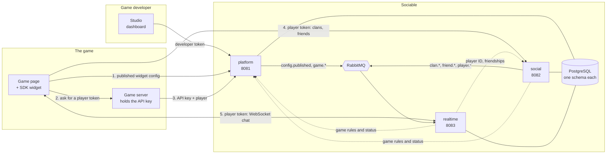

# Overview

What the platform is, what it is made of, and how a request travels through it. Read this first;
each part's own README has the detail.

## What it does

A game developer adds clans, friends and chat to a browser game without building or running a
backend for them. The developer designs a widget in a dashboard, adds two lines to the game's
page, and gives the game server one endpoint. We store the data, enforce the rules and deliver
the messages.

The product name is **Sociable**. The dashboard is called **Studio**.

## The parts

| Part | Repository | What it is | Runs at |
|---|---|---|---|
| **platform** | clan-backend | Developers, admins, games, API keys, the widget's draft and published versions, player tokens | local 8081, `platform.<host>` |
| **social** | clan-backend | Players, clans and their members and roles, friends, blocks | local 8082, `social.<host>` |
| **realtime** | clan-backend | WebSocket connections, conversations, messages, presence, notifications | local 8083, `realtime.<host>` |
| **Studio** | clan-frontend | The developer dashboard and the admin panel (React). Also the public developer guide at `/docs` | local 5173, `studio.<host>` |
| **SDK** | clan-sdk | The script a game loads. Draws the widget and talks to the three services | `sdk.<host>/v1/clan-sdk.js` |
| **Widget UI** | clan-frontend, `packages/ui` | The code that draws the widget. Studio's preview and the SDK both use it, so the preview is what players get | bundled into both |
| **Demo game** | demo-game | An example game with its own small server, used to show and test the integration | local 5174, `game.<host>` |

Behind the three services:

- **PostgreSQL**, one database (`clan`) with one schema and one database user per service
  (`platform`, `social`, `realtime`). A service only touches its own schema.
- **RabbitMQ**, one topic exchange (`socialkit.events`). platform and social publish what
  happened; realtime listens.

The three services are separate programs in one Go module. They never import each other's code.
When one needs another's data it calls an internal HTTP endpoint or reacts to an event.

## The picture

Solid arrows are requests from outside and events. Dotted arrows are internal calls between
services.

## How a request flows

### A developer sets up a game

1. The developer registers and signs in to Studio. Studio talks only to **platform**, with a
   developer token (15 minutes, renewed with a refresh cookie).
2. They register a game and create an API key. The key is shown once; platform stores only a
   hash of it.
3. They design the widget. Studio saves a **draft** to platform as they go.
4. They press Publish. platform checks the draft against the config schema and stores it as a
   new **published version**. Versions are never changed afterwards; a rollback publishes an old
   one again as a new version.
5. platform publishes a `config.published` event. realtime tells every connected player of that
   game, and their widgets load the new version.

### A player opens the widget

1. The game's page loads the SDK and calls `ClanSDK.init`.
2. The SDK fetches the game's published widget config from **platform**. This is public: no
   token, no key.
3. The SDK asks the page for a player token. The page asks its own **game server**, where the
   player is already signed in.
4. The game server calls platform's `POST /api/v1/players/auth` with the **API key** and the
   player's ID and name. platform returns a **player token**, valid for one hour.
5. With that token the SDK reads clans, members and friends from **social**, and opens a
   WebSocket to **realtime**.

The API key never leaves the game server. The browser only ever holds a token for one player.
platform signs tokens with a private key; social and realtime check them with the public key and
never call platform to do it.

### A player does something social

1. The SDK calls **social**, for example to join a clan. social checks the rule (is the clan
   full, is the player already in one) using the game's published config, saves the change, and
   writes an event to its outbox in the same database transaction.
2. A relay publishes the event (`clan.member_joined`) to RabbitMQ.
3. **realtime** receives it, adds the player to the clan's chat room, and sends the other members
   a notification over their WebSockets.

The outbox is why an event is never lost when RabbitMQ is briefly down: the change and the event
are saved together, and the relay retries until the broker confirms.

### A player sends a message

1. The SDK sends `message.send` over the WebSocket.
2. **realtime** checks the game's chat rules (length, slow mode, the rate limit of the
   connection, blocks), stores the message, and answers `message.ack`.
3. It sends `message.new` to every open connection of every member of that conversation.

### An admin suspends a game

1. An admin signs in to the admin panel in Studio, with an admin token. Admins are separate
   accounts, created with `tools/createadmin`; there is no register endpoint for them.
2. They suspend a game or a developer. platform refuses new player tokens for it and publishes
   `game.suspended`.
3. realtime closes that game's open connections, and social refuses its requests.

## Where to read next

| You want to | Read |
|---|---|
| Add the widget to a game | The developer guide in Studio, `/docs` |
| Run the backend on your computer | `README.md`, "Run with Docker" |
| Know every endpoint | `openapi/platform.yaml`, `openapi/social.yaml`, `openapi/realtime.yaml` |
| Know the WebSocket frames | `openapi/realtime-ws.md` |
| Know every event and who publishes it | `docs/events.md`, `docs/event-messages.md` |
| See the realtime flows as diagrams | `docs/realtime-flow.md` |
| Know the widget config format | clan-frontend, `docs/config-v1/` |
| Deploy to the server | `deploy/helm/clan/README.md` |
| Work on Studio | clan-frontend `README.md` |
| Work on the SDK | clan-sdk `README.md` |
