# Realtime flow (UML diagrams)

How a player's actions travel through the services: who calls whom, which event or frame is sent, and where the data is saved.
The diagrams are [Mermaid](https://mermaid.js.org) text, so GitLab and the VS Code Markdown preview draw them, and they stay in git as text.
Names come from the code. If you change a flow, change the diagram in the same merge request.

| Diagram | Shows |
|---|---|
| 1 Components | the services, the database schemas, RabbitMQ and who talks to whom |
| 2 Sign in and connect | a player token, the WebSocket connection and the first frame |
| 3 Friends become a conversation | friend request, accept, and how Realtime reacts |
| 4 Sending a message | `message.send`, the message rules in order, the save and the fan-out |
| 5 Conversation list and history | the two REST reads |
| 6 Marking a conversation read | the `conversation.read` frame |
| 7 Request cancelled or declined, friend removed | the other friend events |
| 8 Conversation lifecycle | a DM as a state machine |
| 9 Frame and event envelope | the classes behind every message |
| 10 Clan rooms | a clan's chat room made from Social's clan events |
| 11 Live re-skin | a published config reaches every open connection of the game (TEAM-148) |
| 12 Presence | who is online, the 10 second grace period, and what friends are told (TEAM-149) |

Every frame the server sends has the event envelope: `event_id`, `type`, `occurred_at`, `game_id`, `data`
(see [`event-messages.md`](event-messages.md) for every message and [`events.md`](events.md) for the details).

## 1 Components

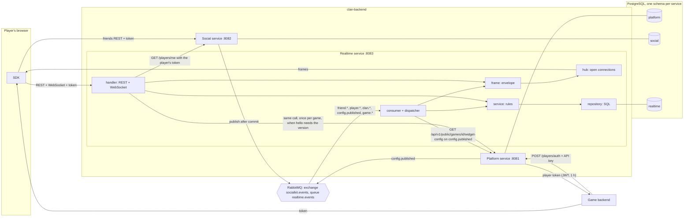

Rules the picture hides: a service only touches its own schema, the game always comes from the verified token and never from a request
or a frame, and Realtime and Social never import each other's code.

## 2 Sign in and connect

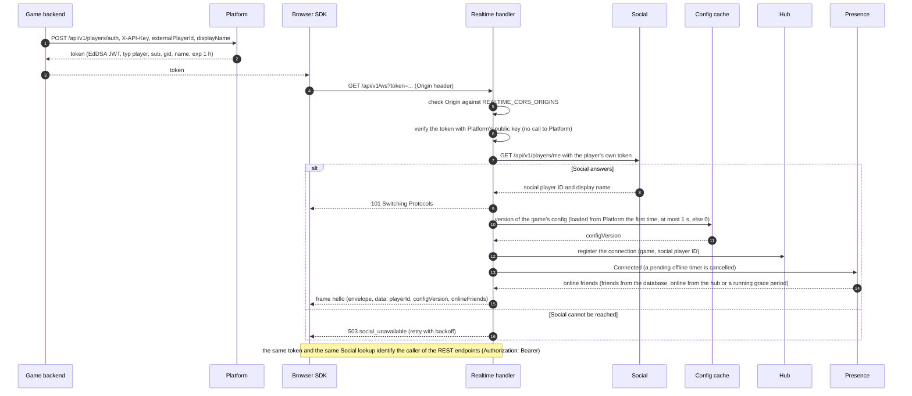

## 3 Friends become a conversation

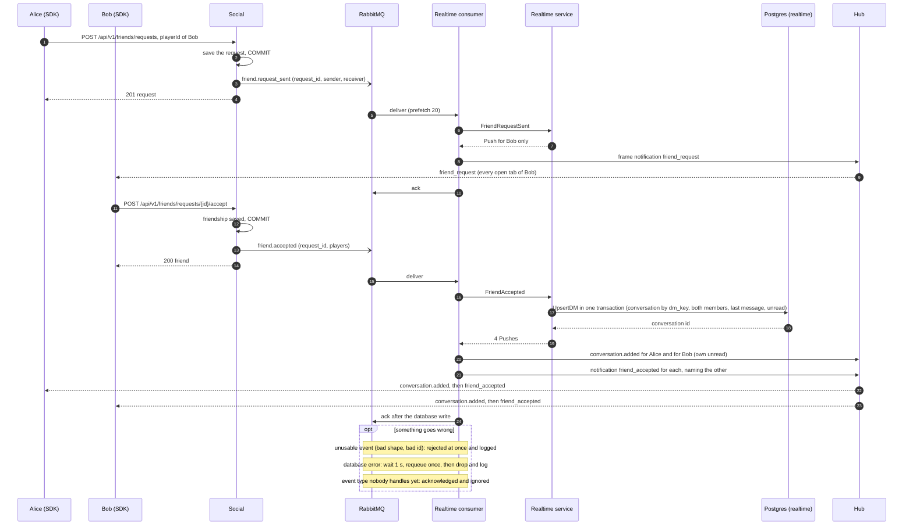

Publishing happens after the commit and a failed publish never fails the request. There is no dead-letter queue yet, so a dropped event is lost.

## 4 Sending a message

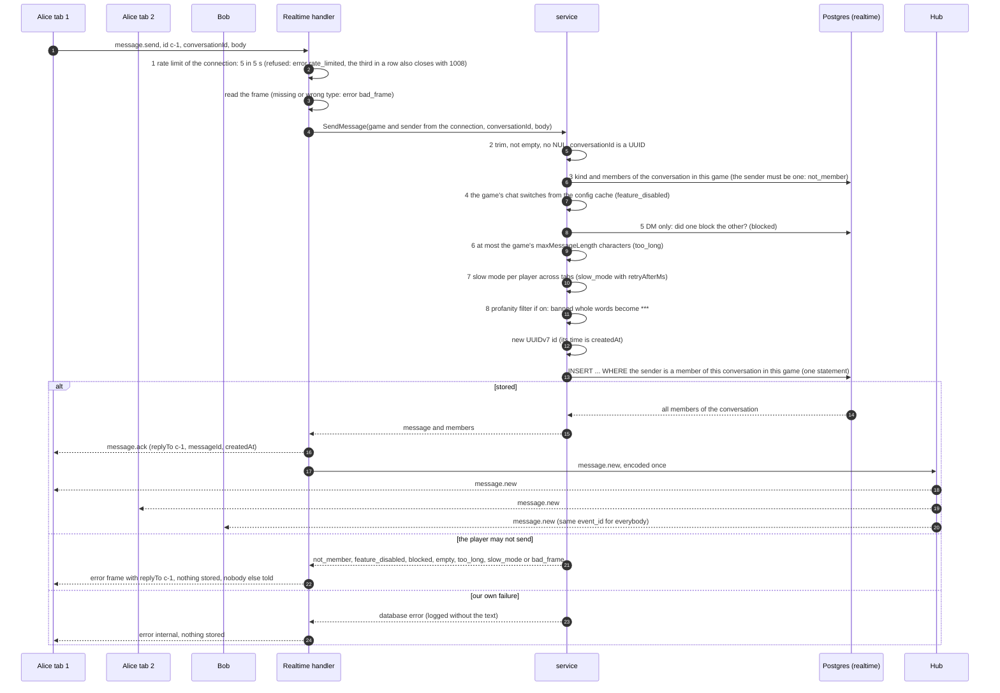

`occurred_at` of both the `message.ack` and the `message.new` is the time the message was stored. A member who is offline reads it from the history later.

## 5 Conversation list and history

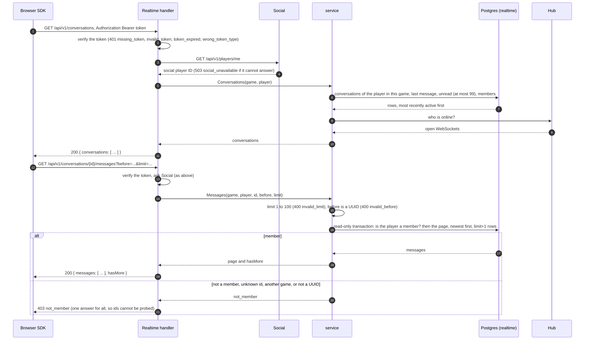

The REST answers are plain JSON. Only frames sent over the WebSocket have the event envelope.

## 6 Marking a conversation read

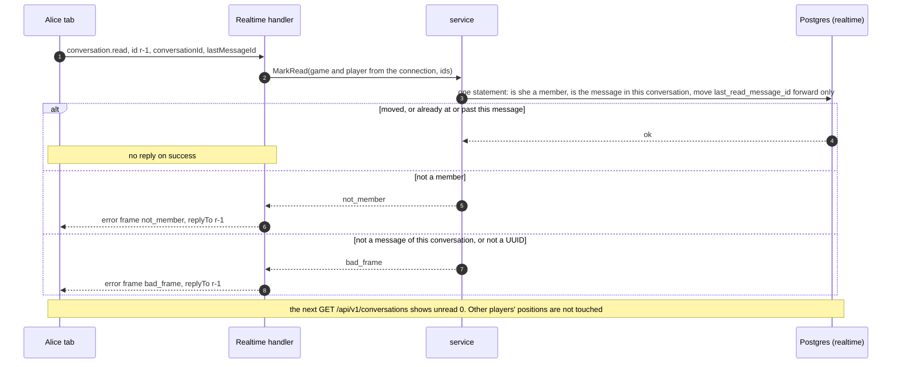

## 7 Request cancelled or declined, friend removed

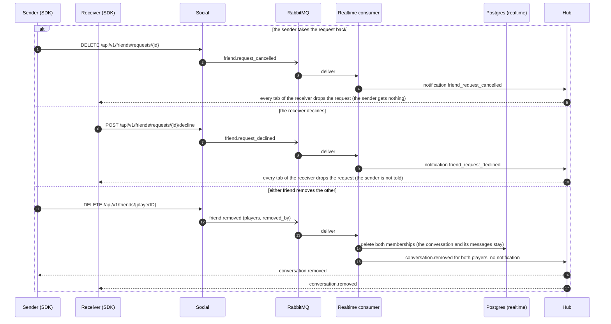

## 8 Conversation lifecycle

A direct-message conversation is one row per pair of players in a game. It is never deleted; only the memberships come and go.

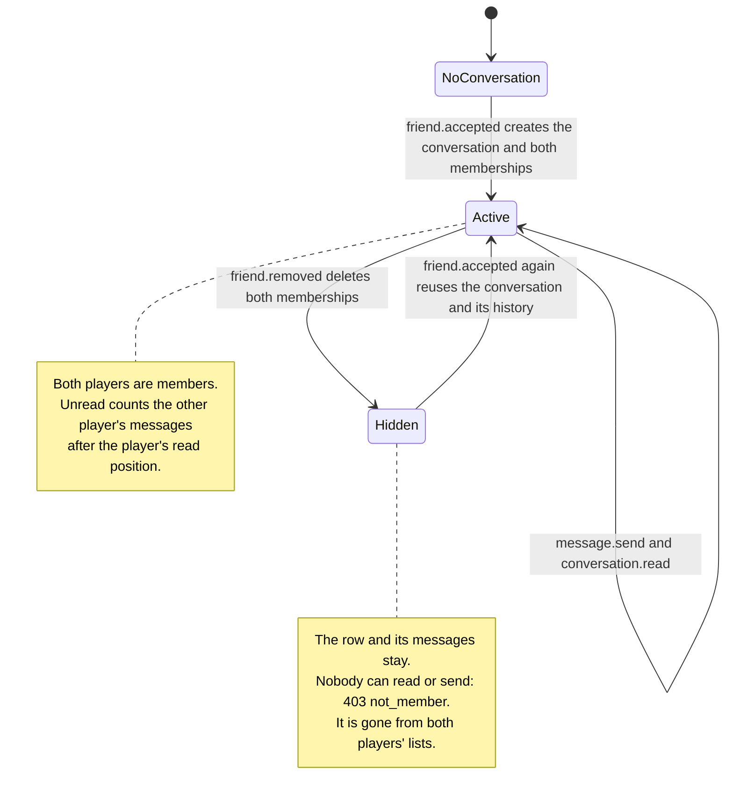

When the friends are reconnected, the read positions start empty again, so the old messages of the other player count as unread.

## 9 Frame and event envelope

Both are the same five fields. The frame is built in `services/realtime/internal/frame` and the event in `pkg/events`.

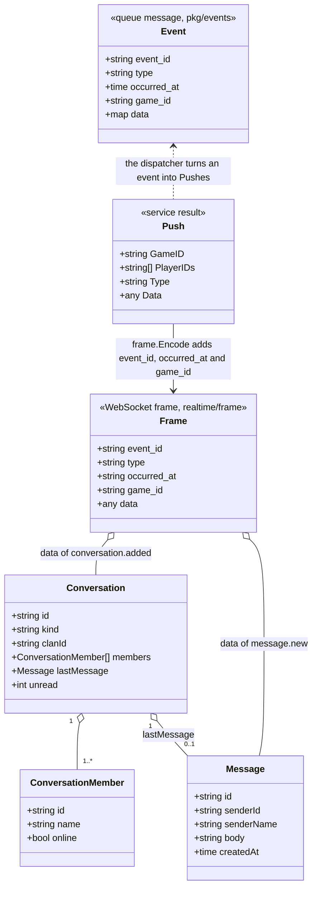

| Field | Meaning in a frame |
|---|---|
| `event_id` | a new random UUID per frame. One `message.new` sent to several players has one id |
| `occurred_at` | the time of the queue event, the time a message was stored, or the sending time for `hello`, `pong` and `error` |
| `game_id` | the game of the connection, always the one from the token |
| `data` | the payload, unchanged by the envelope |

Frames the client sends have no envelope: `{ "type", "id", "data" }`.

## 10 Clan rooms

Realtime builds a clan's chat room from Social's clan events (`services/realtime/internal/service/clans.go`). The frames are in [`event-messages.md`](event-messages.md) under "WebSocket frames". A joiner gets the whole history, also what was written while they were away; `clan.renamed` and `clan.member_role_changed` need nothing from Realtime.

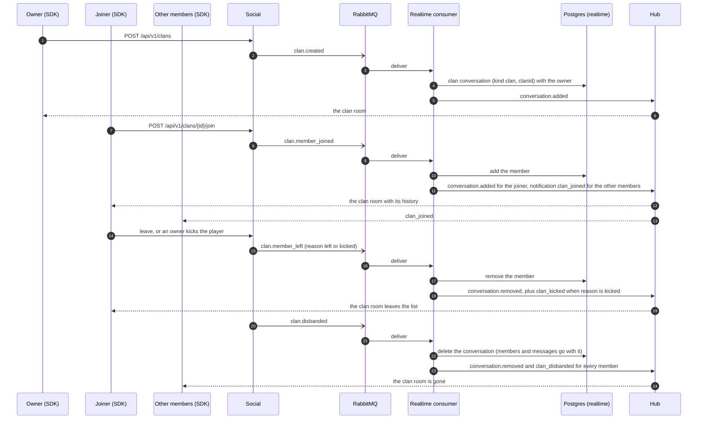

Chat in a clan room is the same `message.send` flow as diagram 4: a clan room is a conversation of `kind` `clan`.

## 11 Live re-skin

The developer presses Publish; every player who has the game open sees the new look without reloading. Realtime fetches the new config
first, so the version in the frame is one it really holds. Platform publishes `config.published` after a publish or rollback is saved.

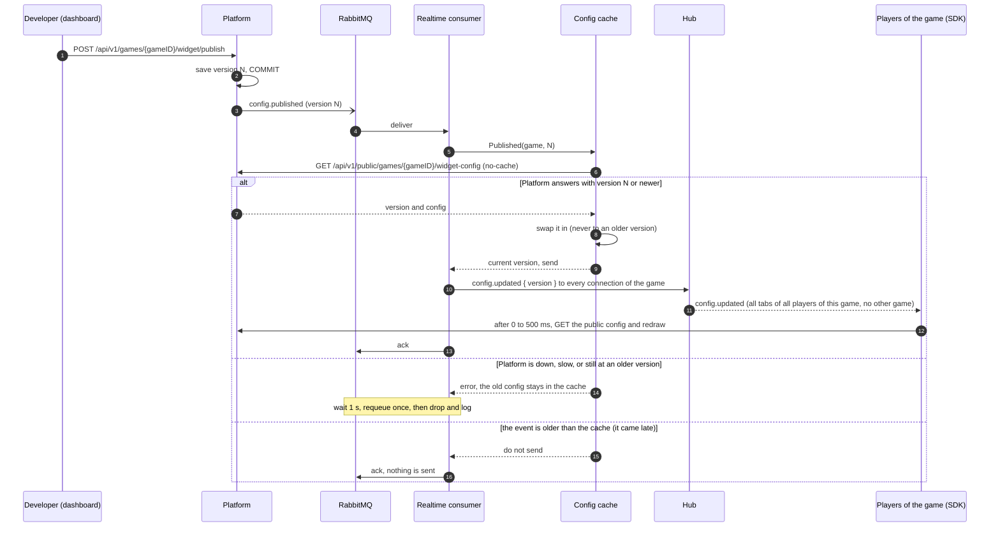

A player who connects later gets the version in `hello` (`configVersion`) and compares it with the one the SDK has. The cache is loaded
lazily from Platform, once per game at a time, and kept in memory.

## 12 Presence

A player is online while one WebSocket of theirs is open. Closing the last one does not make them offline at once: Realtime waits 10 seconds,
because a page refresh closes a socket and opens another a moment later. A player in those 10 seconds still counts as online everywhere
(`hello`, the conversation list). Friends are the other members of the player's DM conversations. Connecting tells friends nothing; they read
`hello.onlineFriends`.

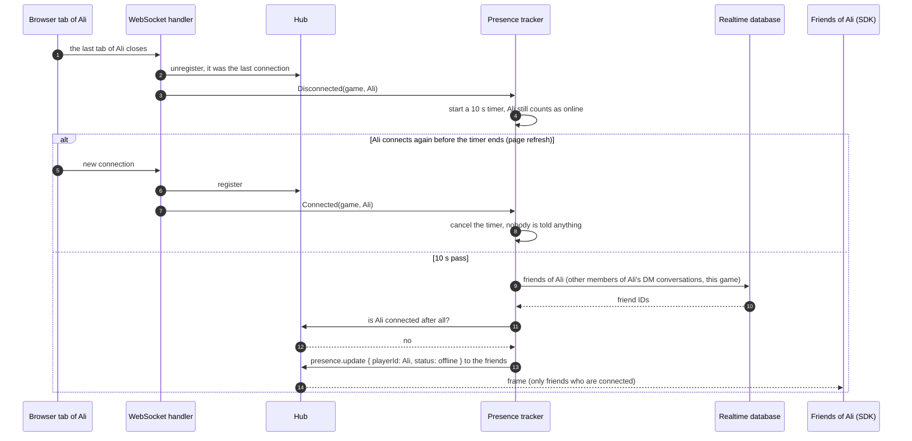

A new friendship between two online players (`friend.accepted`, diagram 3) also sends each of them `presence.update` `online` for the other, right
after `conversation.added`. The timers are in the memory of the process: they are stopped when the service shuts down (nobody is told then), and lost
with a restart.

## Which frame is sent when

| Frame | Sent to | When | Source |
|---|---|---|---|
| `hello` | the new connection | right after the upgrade | WebSocket handler |
| `pong` | the sender of the `ping` | a `ping` frame | WebSocket handler |
| `error` | the sender of a bad frame | any frame the server refuses | WebSocket handler |
| `message.ack` | the sending tab | after a message is stored | `message.send` |
| `message.new` | every tab of every member, the sender's included | after a message is stored | `message.send` |
| `notification` `friend_request` | the receiver | `friend.request_sent` | queue event |
| `notification` `friend_request_cancelled` | the receiver | `friend.request_cancelled` | queue event |
| `notification` `friend_request_declined` | the receiver | `friend.request_declined` | queue event |
| `conversation.added` | both players, each with their own `unread` | `friend.accepted` | queue event |
| `notification` `friend_accepted` | both players | `friend.accepted` | queue event |
| `conversation.removed` | both players | `friend.removed` | queue event |
| `config.updated` | every connection of the game | `config.published` | queue event, after the config is fetched |
| `presence.update` `online` | each of two online players, about the other | `friend.accepted` | queue event, right after `conversation.added` |
| `presence.update` `offline` | the connected friends of the player | 10 s after the player's last connection closed, if they did not come back | presence tracker (no event) |

## When something is down

| What is down | What happens |
|---|---|
| RabbitMQ | Social still answers (a failed publish is only logged), but the events published while the broker is down are lost: there is no outbox yet. Realtime keeps serving WebSockets and REST and reconnects to the broker with 1, 2, 4 ... up to 30 s |
| Realtime database | REST answers 500 `internal_error`, `message.send` answers an `error` frame `internal`, the consumer retries an event once and then drops it; `hello.onlineFriends` is `[]`, and when a player's 10 s end and the friends cannot be looked up, nobody is told and the player stops counting as online |
| Platform | message rules of a game whose config is not cached are the permissive defaults (chat on, 1000 characters, no slow mode, no filter); `hello` says `configVersion` 0 after a second (and for a few seconds after, without asking again); a `config.published` event is retried once and then dropped, so a missed `config.updated` is caught by `configVersion` in the next `hello`. Chat and friends are not affected |
| Social | new WebSocket connections and REST calls to Realtime get 503 `social_unavailable`. Open sockets keep working |
| Realtime itself | events wait in the queue and are handled when it is back. Frames sent meanwhile are not replayed: after a reconnect the SDK reloads the list and the history |
